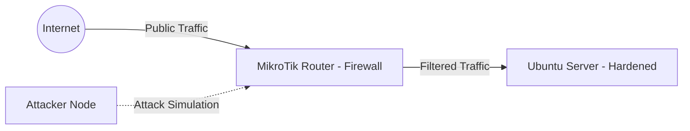

# 🛡️ v1.1.0: Hardening

<div align="center">


</div>

## 1. Overview

This phase takes every weakness confirmed in [v1.0.0-vulnerable.md](./v1.0.0-vulnerable.md) and fixes it, one control at a time: network-level filtering on the MikroTik router, and OS/application-level hardening on the Ubuntu server.

### Network Diagram



### Asset Inventory (Post-Hardening)

| Asset | Role | OS | IP Address | Open Ports | State |
| :--- | :--- | :--- | :--- | :--- | :--- |
| **Core-Gateway** | Edge router / NAT | MikroTik RouterOS v7.21.4 | `10.216.27.1` | 8291 (Winbox) |  |
| **TechSecure-Portal** | Web target | Ubuntu Server 24.04 LTS | `10.216.27.100` | 80 (HTTP), 21 (FTP), 2222 (SSH) |  |

> **Note:** back up your data before hardening a real system — several of these steps change access in ways that are hard to undo if something's missed.


---

## 2. Recap: What Needed Fixing

- **FTP:** anonymous login enabled (response code 230) — unauthenticated credential harvesting.
- **Login logic:** raw string concatenation into the SQL query (`$query = "SELECT * FROM users WHERE user = '$user' AND password = '$pass'"`).
- **Permissions:** `/uploads` set to `777`, allowing arbitrary file uploads.

> **Open item:** the unauthenticated Samba share found in v1.0.0 was never explicitly re-hardened or retested in this cycle — it's a known gap carried forward, not something silently assumed fixed.

---

## 3. Hardening Steps

### A. Host Firewall (UFW)

Default-deny on inbound, open only what's actually needed, and remove the old SSH port once the new one is confirmed working.

```bash
sudo ufw default deny incoming
sudo ufw default allow outgoing

sudo ufw allow 80/tcp
sudo ufw allow 21/tcp
sudo ufw allow 2222/tcp

sudo ufw delete allow 22/tcp
sudo ufw enable
```


### B. SSH Key-Based Auth, Non-Standard Port

```bash
ssh-keygen
```


```bash
cat ~/.ssh/id_ed25519.pub >> ~/.ssh/authorized_keys
chmod 600 ~/.ssh/authorized_keys
```


```bash
sudo nano /etc/ssh/sshd_config
```


```text
Port 2222
PermitRootLogin no
PasswordAuthentication no
MaxAuthTries 3
```


```bash
sudo systemctl restart ssh
ssh -p 2222 ubuntu@10.216.27.100
```


### C. FTP Hardening

```bash
sudo nano /etc/vsftpd.conf
```


```text
anonymous_enable=NO
local_enable=YES
write_enable=YES
anon_root=/var/ftp
```


```bash
sudo systemctl restart vsftpd
```


### D. SQL Injection Fix (Prepared Statements)

```bash
sudo nano /var/www/html/index.php
```


```php
<?php
    $stmt = $conn->prepare("SELECT * FROM users WHERE username = ? AND password = ?");
    $stmt->bind_param("ss", $user, $pass); // "ss" = two string parameters
    $stmt->execute();
    $result = $stmt->get_result();

    if ($result->num_rows > 0) {
        header("Location: dashboard.php");
        exit();
    } else {
        echo "<p style='color: #ff4d4d; text-align: center;'>Login Failed!</p>";
    }
}
?>
```


### E. Upload Directory Permissions & Script Execution Block

```bash
sudo chown -R www-data:www-data /var/www/html/uploads/
sudo chmod -R 755 /var/www/html/uploads/

sudo nano /var/www/html/uploads/.htaccess
```


```apache
<FilesMatch "\.(php|php5|phtml|phar|phtml)$">
    Order Deny,Allow
    Deny from all
</FilesMatch>
```


### F. Server Banner Hardening

Hides Apache's version string from scanners/banner grabbers.

```bash
sudo nano /etc/apache2/conf-available/security.conf
```

```text
ServerTokens Prod
ServerSignature Off
```

```bash
sudo systemctl restart apache2
```


### G. Fail2Ban (SSH Brute-Force Protection)

```bash
sudo apt install fail2ban -y
sudo cp /etc/fail2ban/jail.conf /etc/fail2ban/jail.local
sudo nano /etc/fail2ban/jail.local
```

```text
[sshd]
enabled = true
port = 2222
filter = sshd
logpath = /var/log/auth.log
maxretry = 3
bantime = 3600
```


```bash
sudo systemctl start fail2ban
sudo systemctl enable fail2ban
```


### H. Upload Extension Whitelist

A second, application-level control on top of E: even before a file reaches `move_uploaded_file()`, its extension is checked against a hardcoded whitelist.

```php
// Hardened: strict extension whitelist before any file write happens
$allowed_ext = array("jpg", "jpeg", "png", "pdf", "docx");
$file_ext    = strtolower(pathinfo($file_name, PATHINFO_EXTENSION));

if (!in_array($file_ext, $allowed_ext)) {
    echo "<div class='msg error'><strong>Gagal!</strong> Format file tidak diizinkan.</div>";
} elseif (move_uploaded_file($_FILES["file"]["tmp_name"], $target_file)) {
    echo "<div class='msg success'><strong>Berhasil!</strong> File telah diunggah...</div>";
}
```


### I. MikroTik Perimeter Rules

**Destination NAT** (`IP > Firewall > NAT`):
- Rule 0: `chain=srcnat action=masquerade out-interface=ether1`
- Rule 1: `chain=dstnat action=dst-nat src-address=10.216.27.100 protocol=6(tcp) dst-port=2222 in-interface=ether1`


**Firewall filter rules** (`IP > Firewall > Filter Rules`):
- Rule 0 (forward allow): `chain=forward action=accept protocol=6(tcp) dst-port=2222` — opens the one path needed for SSH into the Ubuntu server.
- Rule 1 (management allow): `chain=input connection-state=established,related action=accept` — keeps the admin's own Winbox session stable.
- Rule 2 (invalid drop): `chain=input connection-state=invalid action=drop` — drops malformed packets and basic DDoS noise.
- Rule 3 (WAN isolation): `chain=input action=drop in-interface=ether1` — blocks unsolicited inbound traffic from outside the LAN.


---

## 4. Summary

| Weakness | Fix | Where |
|---|---|---|
| Anonymous FTP | Disabled anonymous login, local auth only | `vsftpd.conf` |
| SQL injection | Prepared statements, bound parameters | `index.php` |
| Unrestricted upload, `777` permissions | Extension whitelist + `755` perms + `.htaccess` script-execution block | `dashboard.php`, uploads dir |
| SSH brute-forceable | Key-only auth, non-standard port, Fail2Ban | `sshd_config`, Fail2Ban |
| No perimeter filtering | MikroTik NAT + filter rules restricting WAN input | MikroTik |

This is a layered fix, not a single patch: network filtering at the router, OS-level access control on the host, and application-level input/extension validation in the code. The next document, [v1.1.0-Retesting.md](./v1.1.0-Retesting.md), confirms each of these actually holds against a re-attack.

---

<div align="center">
  <sub>Enterprise Homelab Core v1.1.0: Hardened · Maintained by <b>pagarkristian</b></sub>
</div>
