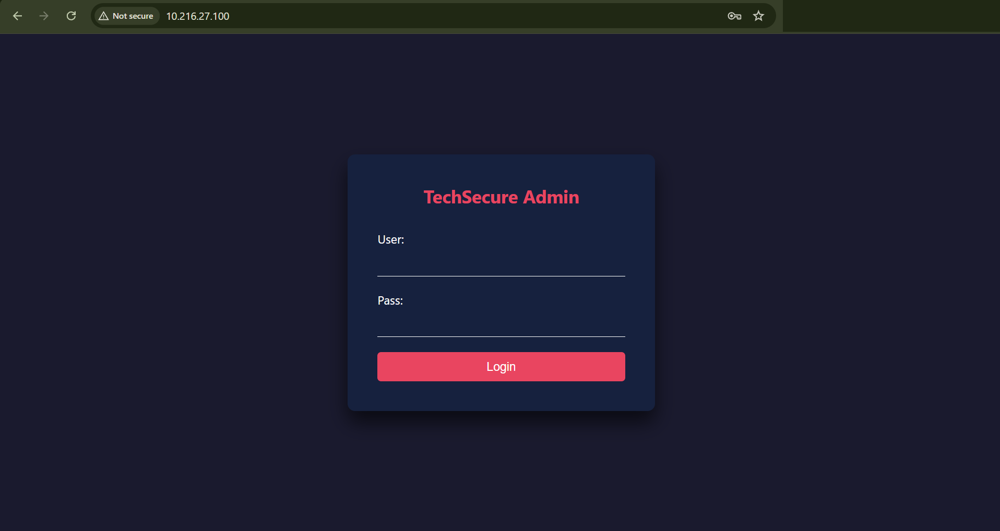
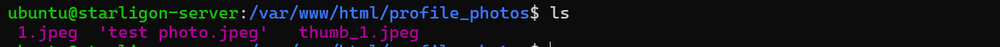
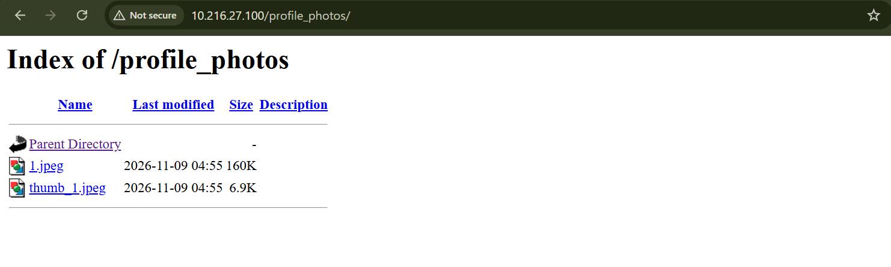
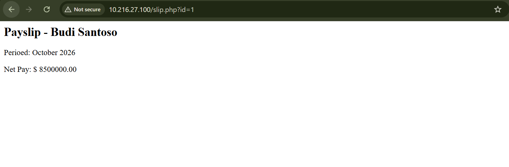
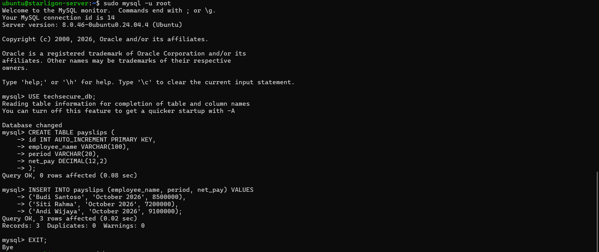

# 🔓 Enterprise Homelab Core v2.0.0: Vulnerable Feature Implementation

<div align="center">


</div>

<div align="center"><sub>Two legitimate business features, built the way a team under deadline pressure actually builds them</sub></div>

---

## 🌟 1. Implementation Overview

<div align="center">

<br><sub>The existing TechSecure portal on <code>10.216.27.100</code>. Both new features sit behind this login.</sub>
</div>

The two requests from [v2.1.0](./v2.1.0-business-context.md) were implemented directly on the hardened v1.1.0 baseline. The code below is **exactly what runs on the target server** (`10.216.27.100`), copied from `/var/www/html/`.

<div align="center">
<table>
<tr><th align="center" width="25%">Feature</th><th align="center" width="35%">What It Does</th><th align="center" width="40%">Where The Mistake Lives</th></tr>
<tr><td align="center"></td><td>Employee uploads a photo, the system resizes it with ImageMagick</td><td>Filename goes into a shell command unsanitized, and file type is never checked</td></tr>
<tr><td align="center"></td><td>Supervisor opens <code>slip.php?id=X</code> to view a payslip</td><td>No ownership check on the ID, and the ID goes straight into the SQL query</td></tr>
</table>
</div>

---

## 📸 2. Feature 1: Profile Photo Upload

### Implementation: `upload-photo.php`

```php
<?php
session_start();
if (!isset($_SESSION['user'])) { die("Unauthorized"); }
if ($_SERVER['REQUEST_METHOD'] == 'POST' && isset($_FILES['photo'])) {
$upload_dir = "/var/www/html/profile_photos/";
$filename = $_FILES['photo']['name'];
$tmp_path = $_FILES['photo']['tmp_name'];
$target = $upload_dir . $filename;
move_uploaded_file($tmp_path, $target);
$resized = $upload_dir . "thumb_" . $filename;
$cmd = "convert " . $target . " -resize 200x200 " . $resized;
shell_exec($cmd);
echo "<p>Profile photo updated.</p>";
}
?>
<form method="POST" enctype="multipart/form-data">
<input type="file" name="photo" required>
<button type="submit">Upload</button>
</form>
```

### ⚠️ Where It Breaks

**Confirmed during testing, not just theory.** A real photo with spaces in its name (`WhatsApp Image 2026-11-09 at 11.36.42.jpeg`) broke the `convert` command. To reproduce it on purpose, a file named `test photo.jpeg` was uploaded. The original was saved, but no thumbnail was created:

<div align="center">

<br><sub><code>ls</code> in <code>profile_photos/</code>: <code>1.jpeg</code> and <code>thumb_1.jpeg</code> (normal name) but no thumbnail for <code>'test photo.jpeg'</code>.</sub>
</div>

The Apache error log shows why. The shell split the filename at the space and passed `photo.jpeg` and `thumb_test` to ImageMagick as separate arguments, because nothing escapes the filename before it reaches `shell_exec()`:

```text
convert-im6.q16: unable to open image `photo.jpeg': No such file or directory @ error/blob.c/OpenBlob/2964.
convert-im6.q16: unable to open image `/var/www/html/profile_photos/thumb_test': No such file or directory @ error/blob.c/OpenBlob/2964.
convert-im6.q16: no decode delegate for this image format `' @ error/constitute.c/ReadImage/581.
convert-im6.q16: no images defined `photo.jpeg' @ error/convert.c/ConvertImageCommand/3234.
```

A space is harmless. The same behaviour with a `;` is not: whatever follows it would be run as a separate command.

<div align="center">
<table><tr><td align="center"><h4>A filename like <code>photo.jpg; id</code> is not treated as a photo name. The part after <code>;</code> is treated as a second shell command.</h4></td></tr></table>
</div>

| # | Weakness | Class | Status |
|---|----------|-------|--------|
| 1 | `$filename` concatenated into `shell_exec()` | OS Command Injection (CWE-78) | **Confirmed** (argument splitting reproduced), exploitation to be tested in attack simulation |
| 2 | No extension or MIME check, original filename kept | Unrestricted File Upload (CWE-434) | Found in code review, to be tested |
| 3 | `/profile_photos/` has directory listing enabled | Information Exposure (CWE-548) | **Confirmed** (see below) |

<div align="center">

<br><sub>Anyone who can reach the server can browse every uploaded file. Combined with weakness 2, an uploaded script would also be easy to find.</sub>
</div>

Both are well known in image-processing pipelines (see ImageTragick, 2016). The second one matters for monitoring: an uploaded `.php` file inside a web-served folder is a very different event from a broken thumbnail.

---

## 💰 3. Feature 2: Payslip Access by ID

### Implementation: `slip.php`

```php
<?php
session_start();
if (!isset($_SESSION['user'])) { die("Unauthorized"); }
$conn = mysqli_connect("localhost", "pengelola", "password_db_123" , "techsecure_db");
$id = $_GET['id'];
$query = "SELECT * FROM payslips WHERE id = $id";
$result = mysqli_query($conn, $query);
$slip = mysqli_fetch_assoc($result);
?>
<h2>Payslip - <?= htmlspecialchars($slip['employee_name']) ?></h2>
<p>Period: <?= htmlspecialchars($slip['period']) ?></p>
<p>Net Pay: Rp <?= htmlspecialchars((string)$slip['net_pay']) ?></p>
```

> Salaries in the database are in rupiah, so the output is labelled `Rp`.

The feature works as intended for a normal request:

<div align="center">

</div>

### ⚠️ Where It Breaks

<div align="center">
<table><tr><td align="center"><h4>Logged in as any user, change the URL to <code>?id=2</code> and you are reading someone else's salary.</h4></td></tr></table>
</div>

| # | Weakness | Class | Status |
|---|----------|-------|--------|
| 1 | Any logged-in user can read any payslip by changing `id` | IDOR / Broken Access Control (OWASP A01) | To be tested |
| 2 | `$id` is placed directly into the SQL query | SQL Injection (CWE-89) | Found in code review, to be tested |

The IDOR request looks completely normal: no malformed input, no injection syntax, just a logged-in user with a different number in the URL. That is exactly why it is a good test for a SIEM.

---

## 🗄️ 4. Supporting Database Setup

<div align="center">

</div>

```sql
CREATE TABLE payslips (
id INT AUTO_INCREMENT PRIMARY KEY,
employee_name VARCHAR(100),
period VARCHAR(20),
net_pay DECIMAL(12,2)
);

INSERT INTO payslips (employee_name, period, net_pay) VALUES
('Budi Santoso', 'October 2026', 8500000),
('Siti Rahma', 'October 2026', 7200000),
('Andi Wijaya', 'October 2026', 9100000);
```

---

## 🧱 5. Components Carried Over from v1.1.0

| File | State |
|------|-------|
| `index.php` | Login uses a prepared statement (SQL injection fixed in v1.1.0). Passwords are still compared in plaintext and DB credentials are hardcoded. |
| `dashboard.php` | Upload with an extension allowlist (`jpg, jpeg, png, pdf, docx`). The original filename is still used as-is. |

---

## 🔄 6. What Comes Next

```diff
+[Vulnerable Features Deployed] ──> [Wazuh SIEM Monitoring]
  (this document)                    (v2.2.0)
                                          │
                                          ▼
+[Attack Simulation] ──> [Detection Engineering] ──> [Retesting & Report]
  (redteam-homelab-toolkit)   (v2.3.0)                (v2.3.1 / v2.4.0)
```

**Snapshot:** `03-TechSecure v2.1.1 Vulnerable` (VirtualBox).

---

<div align="center">
<sub>Enterprise Homelab Core v2.0.0: Vulnerable Features · Maintained by <b>pagarkristian</b></sub>
</div>
