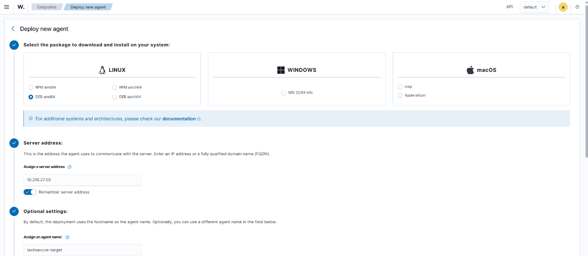
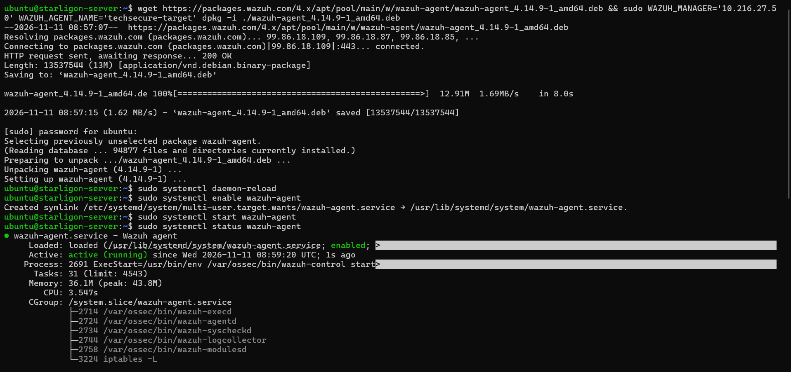
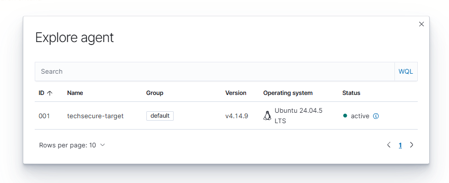
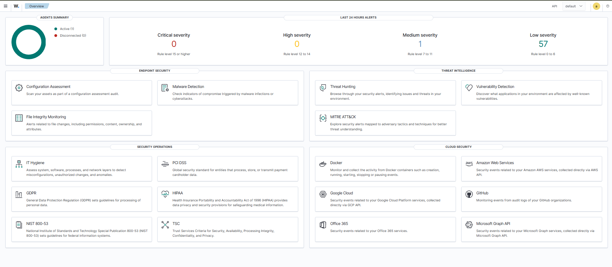
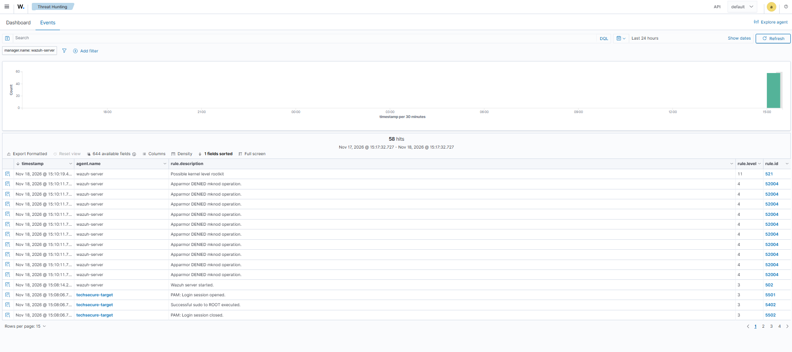
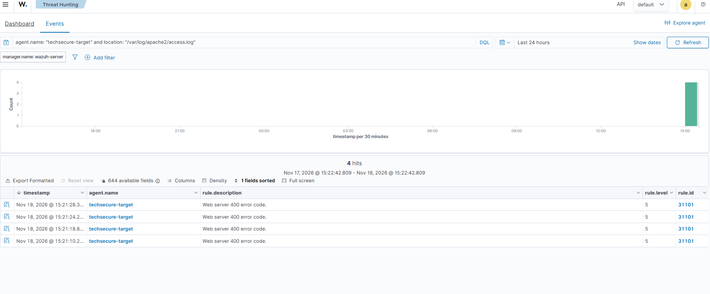

# 📡 Enterprise Homelab Core v2.0.0: Monitoring Setup

<div align="center">


</div>

<div align="center"><sub>Before attacking anything, prove the SIEM can actually see it</sub></div>

---

## 🌟 1. Goal

[v2.1.0](./v2.1.0-business-context.md) asked: *"Are the right logs even reaching the SIEM?"* This phase answers that question for the TechSecure web server. No attack is run here. The only goal is to show that a request to the web server leaves a trail that ends as an alert on the Wazuh dashboard.

```diff
+[Browser / Attacker] ──> [Apache + PHP] ──> [access.log / error.log]
                                                      │
+[Wazuh Dashboard] <── [Wazuh Server] <── [Wazuh Agent reads the log]
```

---

## 🗺️ 2. Lab Components

| Component | Role | Address | Notes |
|-----------|------|---------|-------|
| `wazuh-server` | Wazuh manager, indexer, dashboard (all-in-one) | `10.216.27.50` | Ubuntu 24.04, 8 GB RAM, 4 CPU, 50 GB disk |
| `techsecure-target` | Monitored web server (agent `001`) | `10.216.27.100` | Ubuntu 24.04, Apache + MySQL + PHP |
| Windows host | Source of test requests | `10.216.27.1` | Browser |

All machines share the `10.216.27.0/24` host-only network.

---

## 🖥️ 3. Wazuh Server Setup

The server VM uses two network adapters: NAT (for downloads) and host-only (for the lab network, static IP `10.216.27.50`). Wazuh was installed with the official installation assistant:

```bash
curl -sO https://packages.wazuh.com/4.14/wazuh-install.sh && sudo bash ./wazuh-install.sh -a
```

The `-a` flag installs the indexer, server, and dashboard on one machine. Initial credentials are printed at the end of the install and stored in `wazuh-install-files.tar`. They are not shown in this repository.

---

## 🔌 4. Agent Deployment on the Target

The install command was generated by the dashboard's **Deploy new agent** wizard (Linux, DEB amd64, server address `10.216.27.50`, agent name `techsecure-target`):

<div align="center">

</div>

Then on the target:

```bash
wget https://packages.wazuh.com/4.x/apt/pool/main/w/wazuh-agent/wazuh-agent_4.14.9-1_amd64.deb
sudo WAZUH_MANAGER='10.216.27.50' WAZUH_AGENT_NAME='techsecure-target' dpkg -i ./wazuh-agent_4.14.9-1_amd64.deb
sudo systemctl daemon-reload
sudo systemctl enable wazuh-agent
sudo systemctl start wazuh-agent
sudo systemctl status wazuh-agent
```

<div align="center">

</div>

The agent shows up on the dashboard as **active**:

<div align="center">

</div>

---

## 📥 5. Which Logs the Agent Reads

The agent only sends what is listed as a `localfile` in `/var/ossec/etc/ossec.conf`. The relevant entries on the target:

```xml
<localfile>
  <log_format>journald</log_format>
  <location>journald</location>
</localfile>

<localfile>
  <log_format>apache</log_format>
  <location>/var/log/apache2/error.log</location>
</localfile>

<localfile>
  <log_format>apache</log_format>
  <location>/var/log/apache2/access.log</location>
</localfile>
```

| Source | What it gives the SOC |
|--------|----------------------|
| `journald` | System events: SSH and console logins, `sudo` usage |
| Apache `access.log` | Every web request: who, what URL, what result |
| Apache `error.log` | Server-side errors (for example, failed `convert` calls from the upload feature) |

The three Apache and journald entries were already present in the default configuration, so no manual change was needed. This was confirmed in two ways: the config lines are not commented out, and the agent's own log shows it opened both Apache files:

```text
wazuh-logcollector: INFO: (1950): Analyzing file: '/var/log/apache2/error.log'.
wazuh-logcollector: INFO: (1950): Analyzing file: '/var/log/apache2/access.log'.
```

---

## ✅ 6. Verification

### 6.1 Dashboard overview

One active agent, and alerts already flowing:

<div align="center">

</div>

### 6.2 System events from the target

Under **Threat Hunting → Events**, the SSH session used to administer the target appears as events from `techsecure-target`: `PAM: Login session opened` (rule 5501), `Successful sudo to ROOT executed` (rule 5402), and `PAM: Login session closed` (rule 5502).

<div align="center">

</div>

### 6.3 Web requests become alerts

Five requests to pages that do not exist (`/tes1` to `/tes5`) were sent from the Windows host. The Apache log recorded each one, for example:

```text
10.216.27.1 - - [18/Nov/2026:08:21:27 +0000] "GET /tes5 HTTP/1.1" 404 396 "-" "Mozilla/5.0 (Windows NT 10.0; Win64; x64) ... Chrome/157.0.0.0 Safari/537.36"
```

Filtering the dashboard with:

```text
agent.name: "techsecure-target" and location: "/var/log/apache2/access.log"
```

returns alerts from rule `31101`, *Web server 400 error code*, level 5:

<div align="center">

</div>

### 6.4 Anatomy of one alert

| Question | Field | Value |
|----------|-------|-------|
| Who | `data.srcip` | `10.216.27.1` |
| What | `data.protocol`, `data.url` | `GET /tes5` |
| Result | `data.id` | `404` |
| Where | `agent.name`, `location` | `techsecure-target`, `/var/log/apache2/access.log` |
| Which rule | `rule.id`, `rule.level` | `31101`, `5` |
| Raw evidence | `full_log` | the original Apache line |
| Parsed by | `decoder.name` | `web-accesslog` |

<div align="center">
<table><tr><td align="center"><h4>The pipeline works end to end: Apache log → agent → manager → decoder → rule → alert.</h4></td></tr></table>
</div>

---

## 🔎 7. Observations and Open Questions

| # | Observation | Status |
|---|-------------|--------|
| 1 | Rule `31101` tags every 4xx response with the group `attack`. A single 404 from an internal IP is not an attack, so this rule is noisy and needs analyst judgment. | Observed |
| 2 | The rule reacted to failed requests (404). Successful requests that abuse a feature (for example `slip.php?id=2`, which returns 200) may not alert at all. | **Hypothesis, to be tested in attack simulation** |
| 3 | Five test requests produced four alerts. The difference has not been explained yet. | Open |
| 4 | On `wazuh-server` itself, `Possible kernel level rootkit` (rule 521, level 11) and several AppArmor `mknod` denials appeared shortly after boot. Likely benign on a freshly started VM, but not yet triaged. | Open |
| 5 | The dashboard shows local time (UTC+7), while Apache logs use UTC. The same request appears with a 7-hour difference. | Noted |

---

## 🔄 8. What Comes Next

```diff
+[Monitoring Verified] ──> [Attack Simulation] ──> [Detection Engineering] ──> [Retesting & Report]
  (this document)           (v2.2.1)                (v2.3.0)                    (v2.3.1 / v2.4.0)
```

Next, each weakness from [v2.1.1](./v2.1.1-vulnerable-features.md) is exercised, and observation 2 above is either confirmed or disproved with evidence.

**Snapshot:** `04-wazuh-agent-connected` (VirtualBox).

---

<div align="center">
<sub>Enterprise Homelab Core v2.0.0: Monitoring Setup · Maintained by <b>pagarkristian</b></sub>
</div>
