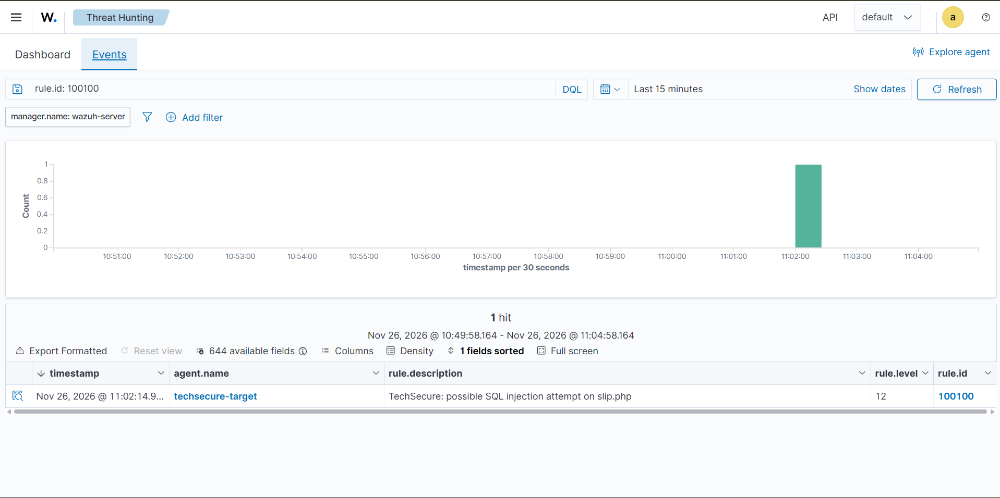
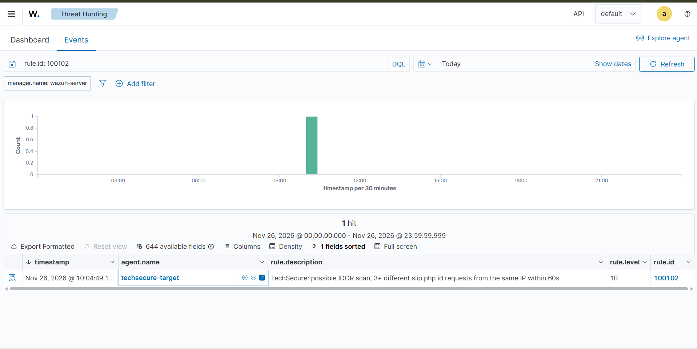
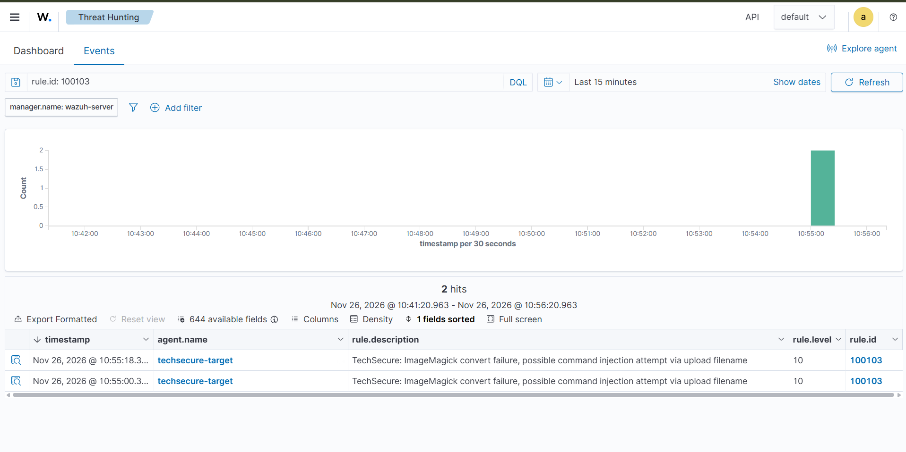

# 🔧 Enterprise Homelab Core v2.0.0: Detection Engineering

<div align="center">


</div>

<div align="center"><sub>For every attack in <a href="https://github.com/pagarkristian/redteam-homelab-toolkit/blob/main/v2.0.0/v2.2.1-attack-simulation.md">v2.2.1</a> that did not alert, write a rule. For every one that did, understand why the default rule caught it.</sub></div>

---

## 🌟 1. Starting Point

Fill this in from the summary table at the end of [v2.2.1-attack-simulation.md](https://github.com/pagarkristian/redteam-homelab-toolkit/blob/main/v2.0.0/v2.2.1-attack-simulation.md):

| Attack | Alerted by default? | Action needed |
|---|---|---|
| IDOR (`slip.php?id=X`) | No — confirmed empty in Wazuh despite the request reaching `access.log` | Write a rule that detects the *pattern* of repeated `id=` access, since no single request looks malicious |
| SQL Injection (`OR 1=1`) | No — same reason, status 200 | Write a rule matching the injection pattern in the URL |
| Unrestricted upload (`.php`) | Not tested yet | — |
| Command injection (filename) | No — and for a different reason than the other two: the log line has no Apache-style prefix at all, so it never even gets decoded as a web event | Write a rule matching the raw error text |

---

## 🧩 2. How a Wazuh Rule Works (concept, read before writing one)

A rule matches on **patterns in the already-decoded fields** of a log line (the same fields you saw in v2.2.0 — `data.url`, `data.id`, `full_log`, etc.), not on the raw text blindly. Custom rules live in:
```
/var/ossec/etc/rules/local_rules.xml
```
and are loaded in addition to the default ruleset. Two building blocks matter here:

- `<if_sid>`: this rule only evaluates if a *parent* rule already matched (for example, "if this was already recognized as a web log event").
- `<url>` or `<match>`: a regular expression tested against a specific field.

**Example skeleton (do not copy blindly — adapt it to what you actually found):**
```xml
<group name="techsecure,">

<rule id="100100" level="10">
  <if_sid>31100</if_sid>
  <url>slip.php</url>
  <description>Possible IDOR attempt: repeated access to slip.php with varying id</description>
  <group>access_control,</group>
</rule>

</group>
```

Rule IDs `100000`–`119999` are reserved for custom rules, so they never collide with the default ruleset.

---

## 🎯 3. Rule 1 — SQL Injection Pattern on `slip.php`

**What to detect:** the `OR`, `UNION`, `SELECT`, `--`, or quote characters appearing inside the `id` parameter of `slip.php`.

```xml
<rule id="100100" level="12">
  <if_group>web</if_group>
  <url type="pcre2">slip\.php\?id=.*(OR|UNION|SELECT|--|'|%27)</url>
  <options>no_full_log</options>
  <description>TechSecure: possible SQL injection attempt on slip.php</description>
  <group>sql_injection,</group>
</rule>
```

Applied on `wazuh-server`:
```bash
sudo nano /var/ossec/etc/rules/local_rules.xml
sudo /var/ossec/bin/wazuh-analysisd -t
sudo systemctl restart wazuh-manager
```

**Result:** Re-running `slip.php?id=1 OR 1=1` fired the rule immediately — **1 hit, rule `100100`, level 12**, description *"TechSecure: possible SQL injection attempt on slip.php"*, agent `techsecure-target`.

<div align="center">

</div>

---

## 🎯 4. Rule 2 — IDOR / Sequential `id` Scanning on `slip.php`

**What to detect:** this is harder than Rule 1, because a *single* `?id=2` request looks completely legitimate — there's no bad syntax to match. What is suspicious is the **pattern over time**: the same IP requesting `slip.php?id=` with several different values in a short window. One request is normal use; three different `id` values from the same source within a minute is not something a real employee would ever do — nobody needs to open their own payslip, then immediately open two other people's.

This needs a base rule that matches any `slip.php?id=` request, and a second frequency-based rule that escalates when the base rule fires repeatedly from the same source:

```xml
<rule id="100101" level="3">
  <if_group>web</if_group>
  <url type="pcre2">/slip\.php\?id=\d+</url>
  <description>TechSecure: slip.php accessed with an id parameter</description>
  <group>access_control,</group>
</rule>

<rule id="100102" level="10" frequency="3" timeframe="60">
  <if_matched_sid>100101</if_matched_sid>
  <same_source_ip />
  <description>TechSecure: possible IDOR scan, 3+ different slip.php id requests from the same IP within 60s</description>
  <group>access_control,</group>
</rule>
```

**Result:** Requesting `id=1`, `id=2`, `id=3` in quick succession triggered **rule `100102`, level 10, 1 hit** — *"TechSecure: possible IDOR scan, 3+ different slip.php id requests from the same IP within 60s"*, agent `techsecure-target`.

<div align="center">

</div>

---

## 🎯 5. Rule 3 — Suspicious Upload Filename (and a real debugging story)

**What to detect:** the `convert-im6` failure signature that shows up in `/var/log/apache2/error.log` whenever ImageMagick chokes on a crafted filename.

**First attempt (failed):**
```xml
<rule id="100103" level="10">
  <if_group>web</if_group>
  <match>convert-im6</match>
  <description>TechSecure: ImageMagick convert failure in Apache error log, possible command injection attempt via upload filename</description>
  <group>command_injection,</group>
</rule>
```
This did **not** fire after re-running the upload attack, even though the `convert-im6` text was clearly sitting in `error.log`. Instead of guessing at more rules, this was debugged directly on `wazuh-server` with Wazuh's own rule tester:
```bash
sudo /var/ossec/bin/wazuh-logtest
```
Pasting the exact log line in:
```
convert-im6.q16: missing required argument  @ error/convert.c/ConvertImageCommand/545.
```
returned:
```
**Phase 2: Completed decoding.
        No decoder matched.

**Phase 3: Completed filtering (rules).
        id: '1002'
        description: 'Unknown problem somewhere in the system.'
```

**Root cause:** the line has none of Apache's usual prefix (`[date] [module] [pid] [client]`) — it's raw output from the `convert` process that happened to land in the same file, not something Apache itself wrote in its normal format. Because no decoder recognized it as an Apache log line, it was never tagged with the `web` group, and `<if_group>web</if_group>` in the rule above silently excluded it every time. The fix was to drop that condition and match on the text alone:

```xml
<rule id="100103" level="10">
  <match>convert-im6</match>
  <description>TechSecure: ImageMagick convert failure, possible command injection attempt via upload filename</description>
  <group>command_injection,</group>
</rule>
```

**Result after the fix:** re-running the upload attack fired the corrected rule — **2 hits, rule `100103`, level 10** — *"TechSecure: ImageMagick convert failure, possible command injection attempt via upload filename"*, agent `techsecure-target`.

<div align="center">

</div>

---

## 📊 6. Summary

| Rule | Detects | Status |
|---|---|---|
| `100100` | SQLi pattern (`OR`/`UNION`/`SELECT`/`--`/quotes) in `slip.php?id=` | ✅ Confirmed firing |
| `100101` + `100102` | 3+ different `slip.php?id=` values from the same IP within 60s (IDOR scan) | ✅ Confirmed firing |
| `100103` | `convert-im6` failure signature in Apache error log (upload command injection) | ✅ Confirmed firing, after fixing the `if_group web` bug above |

**Honest limitations:**
- **Rule `100100` matches literal keywords.** A SQLi payload that avoids the words `OR`, `UNION`, `SELECT`, `--`, and quote characters — for example one using comment tricks, encoded characters not already covered, or boolean logic phrased differently — would slip through untouched. This is a signature, not a true understanding of SQL syntax.
- **Rule `100102` has a blind spot by design.** An attacker who scans one `id` every 2-3 minutes instead of 3 times in 60 seconds stays under the frequency threshold indefinitely. The timeframe and count were picked to match what was tested here, not derived from a real baseline of normal usage — in a real deployment this would need tuning against actual traffic, and probably a longer observation window rather than just a short burst.
- **Rule `100103` only catches this one attack because of a tooling accident.** It works by matching ImageMagick's own crash message, not by inspecting the uploaded filename directly. A payload that didn't make `convert` fail and print to `error.log` (for example, a command injection that succeeded silently, or one that used a tool other than `convert`) would produce no log line for this rule to match at all. This is a detection of a side-effect, not of the underlying vulnerability.
- **None of these three rules look at the request body.** All of them key off the URL or a log side-effect. A payload submitted purely via POST body (not in `/slip.php?id=...` or a filename) wouldn't be visible to any rule here, because Apache's standard `access.log` doesn't record POST bodies at all — this was actually discovered the hard way during testing, when an upload attempt to the wrong feature (`dashboard.php`) produced no useful log trail to debug against.

---

## 🔄 7. What Comes Next

```diff
+[Detection Engineering] ──> [Retesting]
  (this document)              (v2.3.1)
```

Next: re-run every attack from v2.2.1 one more time, against the now-improved ruleset, and confirm each one is caught.

---

<div align="center">
<sub>Enterprise Homelab Core v2.0.0: Detection Engineering · Maintained by <b>pagarkristian</b></sub>
</div>
