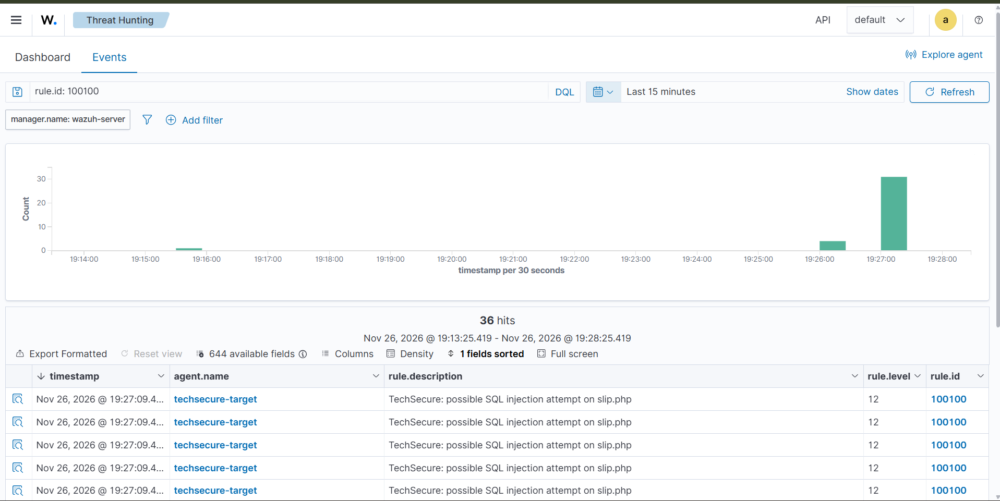
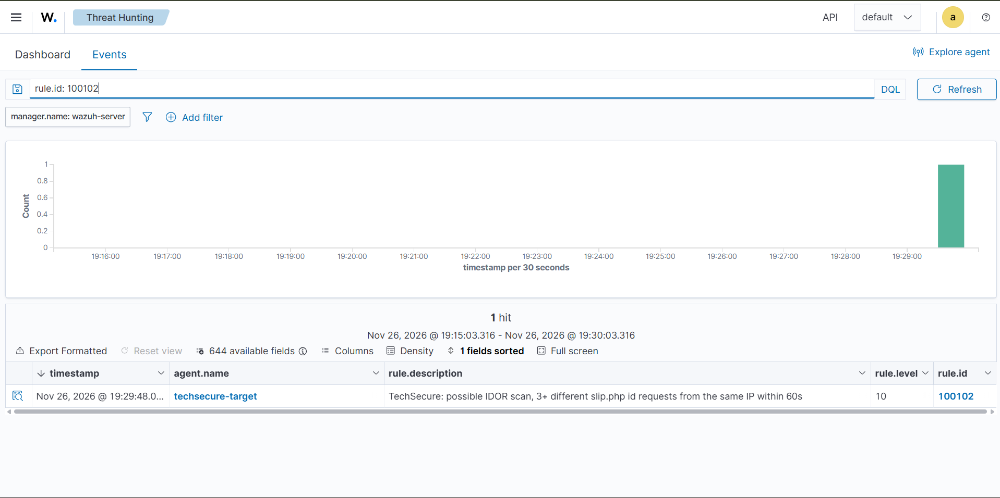
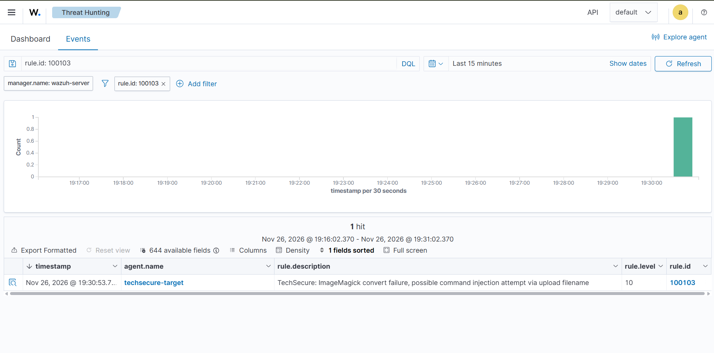
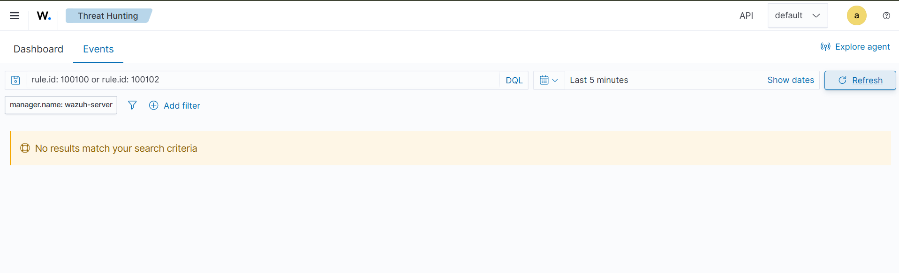
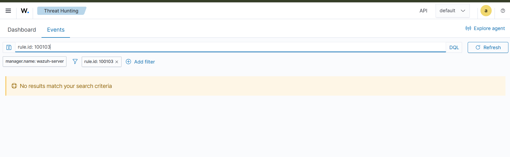

# 🔁 Enterprise Homelab Core v2.0.0: Retesting

<div align="center">


</div>

<div align="center"><sub>Do the custom rules from <a href="./v2.3.0-detection-engineering.md">v2.3.0</a> actually catch the attacks from <a href="https://github.com/pagarkristian/redteam-homelab-toolkit/blob/main/v2.0.0/v2.2.1-attack-simulation.md">v2.2.1</a> now?</sub></div>

---

## 🌟 1. Why This Phase Exists

A rule that worked once, right after you wrote it, isn't proven. This phase repeats the exact same attacks from the attack simulation, cold — in a separate session, not immediately after writing each rule — and checks the dashboard, the same way a real retest after a remediation would be done. It also adds a check that v2.3.0 didn't do: confirming the new rules stay **silent** during normal, legitimate use of the same features.

---

## ✅ 2. Retest 1 — SQL Injection

**Run again:**
```
http://10.216.27.100/slip.php?id=1 OR 1=1
```

**Result:** Rule `100100` fired again — **36 hits** over a ~15-minute window (`19:15`–`19:28`), level 12, same description as before: *"TechSecure: possible SQL injection attempt on slip.php"*. The high hit count reflects the payload being re-submitted several times during the retest session (page reloads, re-checking the URL), not 36 separate attack attempts — but the important part is that **every single submission of the payload was caught, with no gaps**.

<div align="center">

</div>

---

## ✅ 3. Retest 2 — IDOR Scan

**Run again, in quick succession:**
```
http://10.216.27.100/slip.php?id=1
http://10.216.27.100/slip.php?id=2
http://10.216.27.100/slip.php?id=3
```

**Result:** Rule `100102` fired — **1 hit**, level 10, *"TechSecure: possible IDOR scan, 3+ different slip.php id requests from the same IP within 60s"*. As designed, this rule only triggers once the 3rd distinct `id` request lands within the 60-second window — it doesn't fire on the 1st or 2nd request alone, only on crossing the threshold.

<div align="center">

</div>

---

## ✅ 4. Retest 3 — Suspicious Upload

**Run again:** uploaded `test;whoami.jpg` through `upload-photo.php`, same as Attack 3.

**Result:** Rule `100103` fired — **1 hit**, level 10, *"TechSecure: ImageMagick convert failure, possible command injection attempt via upload filename"* — confirming the earlier fix (removing the `<if_group>web</if_group>` condition after debugging with `wazuh-logtest`) holds up on a fresh, independent run.

<div align="center">

</div>

---

## ⚠️ 5. False Positive Check

A rule that fires on everything is as useless as one that fires on nothing. Do a quick sanity check: perform **normal, legitimate use** of the same features and confirm the new rules stay quiet.

**Test 1 — single normal payslip view:**
```
http://10.216.27.100/slip.php?id=1
```
opened once, waited a full minute (so it couldn't be counted together with the earlier IDOR-scan retest), then searched:
```
rule.id: 100100 or rule.id: 100102
```
over **Last 5 minutes**.

**Result: "No results match your search criteria."** A single legitimate view of one's own payslip does not trip either the SQLi or the IDOR-scan rule.

<div align="center">

</div>

> **A note on getting this right the first time:** the first attempt at this check returned "No results" too, but it turned out to be a false negative, not a real pass — a leftover filter pill from the previous check (`rule.id: 100103`) was still active *alongside* the new search query, making the combined condition impossible to satisfy regardless of what happened. Removing the stray filter and re-running the test was necessary before the "No results" here could be trusted as real evidence.

**Test 2 — normal photo upload:** uploaded a file named `test.jpg` (no shell metacharacters) through `upload-photo.php`, then searched `rule.id: 100103` over Last 5 minutes.

**Result: "No results match your search criteria."** A routine upload with a normal filename does not trip the command-injection rule.

<div align="center">

</div>

**Conclusion:** none of the three custom rules fired on legitimate use. No tuning was needed this round.

---

## 📊 6. Before / After Comparison

| Attack | Before (v2.2.1 baseline, default ruleset) | After (this retest, custom rules) |
|---|---|---|
| IDOR (`slip.php?id=2/3`) | No alert at all — confirmed absent despite the request reaching `access.log` | ✅ Rule `100102` fires, 1 hit, on the 3rd distinct `id` within 60s |
| SQL Injection (`OR 1=1`) | No alert — status 200, nothing for a generic rule to flag | ✅ Rule `100100` fires reliably, every submission caught |
| Unrestricted upload (`.php`) | Not tested yet (open from v2.2.1) | Not tested yet |
| Command injection (filename `;`) | No alert — log line not even decoded as an Apache event | ✅ Rule `100103` fires, 1 hit, consistent across two independent runs |

Legitimate use of all three features (normal payslip view, normal upload) produced **zero false positives** across both rules tested for it.

---

## 🔄 7. What Comes Next

```diff
+[Retesting] ──> [Incident Report]
  (this document)   (v2.4.0)
```

**Snapshot after this phase:** `07-retesting-complete`.

---

<div align="center">
<sub>Enterprise Homelab Core v2.0.0: Retesting · Maintained by <b>pagarkristian</b></sub>
</div>
